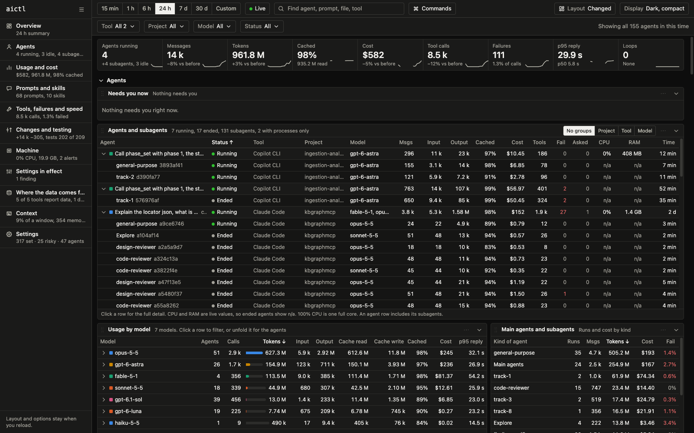
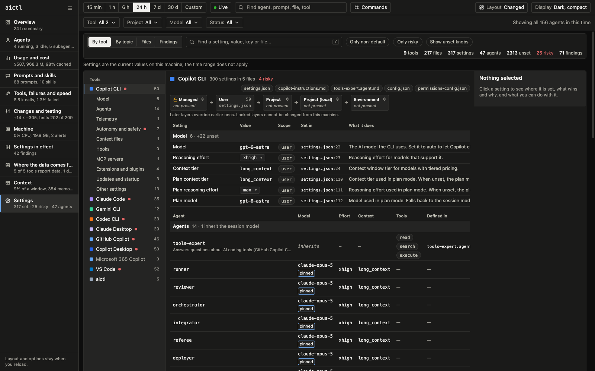
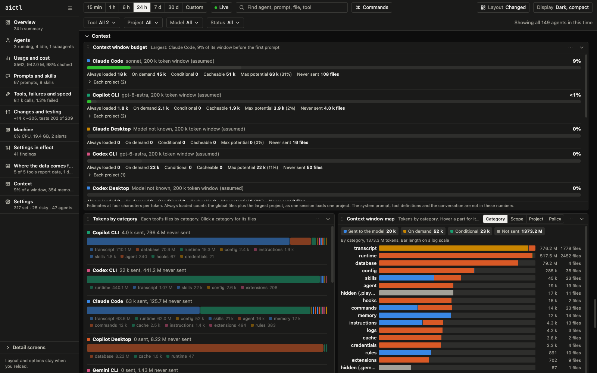

# aictl

**One control plane for every AI coding tool on your machine.**

[](pyproject.toml)
[](HOWTO.md#install-on-windows)
[](LICENSE)
[](#how-it-works)

Claude Code, Copilot, Cursor, Codex, Gemini — each with its own instruction
files, MCP servers, hooks, memory, background processes, and token bills.
**aictl** gives you a single place to *define* what they should know and to
*see* what they are actually doing.



*The board (`aictl daemon serve`): one screen across 14 supported tools.
Sections for agents, usage and cost, prompts and skills, tools and failures,
changes and testing, the machine, settings in effect, data sources and
context; a drawer for every agent, file, skill and prompt; a Settings screen
for every knob of every tool.*

> For step-by-step tasks, see **[HOWTO.md](HOWTO.md)**.

## Two problems, one tool

**📝 Context control** — write your project's AI context once, in human
terms, in a single `.context.toml`: instructions, commands, skills, MCP
servers, hooks, rules, memory. Then:

- **Deploy** it to every tool's native format (`CLAUDE.md`, Copilot
  instructions, Cursor rules, Windsurf rules, …) with one command
- **Switch by mode** — `debug`, `docs`, `review` profiles each carry their
  own instructions, commands, and agent memory; deploy rotates everything,
  including a profile-aware memory swap
- **Scope by directory** — `.context.toml` files nest; a microservice
  loads only what is relevant to it
- **Import** what you already have — reverse-generate `.context.toml`
  from existing native files, so nothing is lost
- **Package** context as a distributable Claude Code plugin

**🔭 Runtime visibility** — a live local dashboard, TUI, and REST API over
everything the tools do:

- **Sessions** — every session across every tool: duration, tokens, cost,
  files touched, the full conversation, tool calls with their actual
  inputs, process trees, agent teams, and a kill switch for runaways
- **Tokens & cost** — real telemetry (OTel + hooks + session files), daily
  budget charts, per-model breakdowns — with double-counting bugs
  engineered out
- **Processes & MCP servers** — what is running right now, per tool, with
  anomaly detection and cleanup hints
- **Context window map** — which files are loaded into the LLM context,
  token cost per category, sent-to-LLM vs on-demand
- **File history** — every AI-related config/instruction file is content-
  tracked, so you can see when context drifted (secrets are excluded by
  a sensitive-file guard)
- **Self-observability** — the monitor watches itself: ingester health,
  data-quality events, snapshot staleness, dropped samples — a dead
  collector cannot masquerade as "live"

Everything runs locally. No cloud dependency, no accounts, no data leaves
your machine; the dashboard binds to loopback with CORS/CSRF protections.

## Quick Start

```bash
# 1. Install (see HOWTO.md)
pipx install "aictl[all] @ git+https://github.com/zvi-code/aictl.git"
# …or from a clone: pipx install ".[all]"

# 2. Start the dashboard (opens your browser)
aictl daemon serve

# 3. Use any AI tool — Copilot, Claude Code, Cursor, Codex, Gemini …
#    Sessions, tokens, processes, and MCP servers appear as they happen.

# 4. See what is running from the terminal (no daemon needed, writes nothing)
aictl ps
aictl top

# 5. Take control of your context
cd my-project
aictl ctx init                      # scaffold .context.toml
aictl ctx deploy --profile debug    # → CLAUDE.md, Copilot rules, Cursor rules, …
```

To connect live AI telemetry (exact token counts, latency, session traces):

```bash
aictl enable                        # one-shot: hooks + OTel + VS Code agent settings
aictl daemon serve                  # now receives OTel from Claude Code, Copilot, Codex
```

Or for the current shell only: `eval $(aictl otel enable --print)`. In PowerShell:
`aictl otel enable --print --shell powershell | Invoke-Expression`.

To undo all of it: `aictl disable --dry-run`, then `aictl disable`.

## Screenshots

### Settings in effect



*Every knob of every tool, set or unset, with the file and line it comes from
and the scope that wins (managed, user, project, project-local, environment).
Per-agent models, efforts and context tiers are read from the agent files and
the tool settings. Risky values are marked; unset knobs show on request.*

### Context



*What is in the context window: the budget each tool spends before the first
prompt, tokens by category and by scope, the memory files that load, and the
files each tool reads with their size and token estimate.*

## Install

Install globally with [pipx](https://pipx.pypa.io) (recommended — keeps `aictl` isolated from other Python projects):

```bash
# Full install from the Git URL: CLI + web dashboard + TUI + process detection
pipx install "aictl[all] @ git+https://github.com/zvi-code/aictl.git"

# Or from a clone
pipx install ".[all]"
```

Install, update, removal, Windows and troubleshooting steps are in [HOWTO.md](HOWTO.md).

### Storage backends: SQLite (default) or Kusto

aictl keeps its history in a local SQLite file by default (`~/.config/aictl/history.db`, split per repository, bounded by `max_total_mb`); nothing needs to be set up. The alternative backend is a [Kusto (Azure Data Explorer)](https://learn.microsoft.com/azure/data-explorer/) cluster, or a Fabric Eventhouse: every table is a table of one Kusto database, remote writes use streaming ingestion by default, and the daemon serves entirely from the cluster. Set it in the config file (`~/.config/aictl/config.toml` on macOS and Linux, `%APPDATA%\aictl\config.toml` on Windows; `[storage] kusto_cluster = "https://mycluster.westus.kusto.windows.net"`, `kusto_database = "aictl"`) or pass it once:

```bash
aictl daemon serve --kusto-cluster https://mycluster.westus.kusto.windows.net --kusto-database aictl
```

For small development/test writes, `--kusto-ingestion inline` selects synchronous non-streaming ingestion as the global default. Use `--kusto-table-ingestion path_defs=inline` to override only one table, or combine a global default with repeated table overrides. Equivalent TOML and environment settings, precedence, and limitations are documented under [ingestion modes](docs/kusto-cluster.md#global-ingestion-mode-and-per-table-overrides). Inline ingestion is not queued ingestion.

The `kusto` extra brings the SDKs (`pipx install "aictl[all]"` includes it). Sign-in is the Azure CLI's by default (`az login`; add `--scope "https://<cluster host>/.default"` when the tenant asks for multi-factor authentication); `kusto_auth` picks `device`, `managed-identity` or `none` (the local emulator). The signed-in account needs the Database Admin role on an existing, empty database; aictl creates the tables. The first start writes the machine's recent history to the cluster and takes a few minutes; later starts and polls are quick. An existing SQLite history is not moved to the cluster. Step by step, including creating a cluster, access and identities, or running the free emulator, in [docs/kusto-cluster.md](docs/kusto-cluster.md); design in [docs/architecture.md](docs/architecture.md#kusto-store-kusto); every table in [docs/kusto-schema.md](docs/kusto-schema.md).

## How It Works

### Deploy: `.context.toml` → native tool files

```
my-project/
├── .context.toml                    ← root: instructions + commands + skills + MCP + hooks + LSP
├── services/ingestion/.context.toml ← sub-scope: scoped instructions
└── services/query-engine/.context.toml
```

```bash
aictl ctx deploy --root my-project/ --profile debug
```

Generates all native files at the root:

```
my-project/
├── CLAUDE.md                         ← Claude Code base instructions
├── CLAUDE.local.md                   ← profile + agent overlay
├── .claude/rules/services-ingestion.md  ← scoped (glob-matched)
├── .claude/commands/investigate.md   ← slash command
├── .claude/skills/flame-graph/SKILL.md
├── .mcp.json                         ← MCP servers
├── .lsp.json                         ← LSP servers (for plugins)
├── .claude/settings.local.json       ← lifecycle hooks
├── .github/copilot-instructions.md   ← Copilot repo-wide
├── .github/agents/debugger.agent.md  ← Copilot agent
├── .github/prompts/investigate.prompt.md ← VS Code prompt file
├── .cursor/rules/base.mdc            ← Cursor rule
├── .cursor/rules/profile-active.mdc
├── AGENTS.md                         ← Copilot/Cursor profile
└── .ai-deployed/manifest.json        ← tracks files for cleanup
```

Switch profile — old files removed, new files created, memory swapped:

```bash
aictl ctx deploy --root my-project/ --profile docs
```

### Import: native tool files → `.context.toml`

Already have `CLAUDE.md`, `.github/copilot-instructions.md`, or `.cursor/rules/`? Import them into `.context.toml`:

```bash
aictl import --root my-project/
```

Reads native files from all detected tools and generates `.context.toml` files at each relevant directory level:

```
my-project/
├── .context.toml                    ← reconstructed from CLAUDE.md, copilot-instructions.md, etc.
├── services/ingestion/.context.toml ← reconstructed from scoped rules
└── services/query-engine/.context.toml
```

Works with both aictl-generated files (strips deployment markers) and hand-written files. When multiple tools have overlapping content, use `--prefer` to pick the authoritative source:

```bash
aictl import --root . --prefer claude
```

Running `aictl ctx deploy` on the imported `.context.toml` files reproduces the original native files.

### Plugin: package as a Claude Code plugin

Build a distributable Claude Code plugin from your `.context.toml` files:

```bash
aictl plugin build --root my-project/ --name my-plugin --profile debug
```

Generates a complete plugin structure:

```
my-project/plugin/
├── .claude-plugin/plugin.json   ← manifest
├── commands/investigate.md      ← slash commands
├── skills/flame-graph/SKILL.md  ← agent skills
├── agents/debugger.md           ← custom agents
├── hooks/hooks.json             ← lifecycle hooks
├── .mcp.json                    ← MCP servers
├── .lsp.json                    ← LSP servers
└── settings.json                ← default agent
```

Test locally with `claude --plugin-dir ./plugin`, then submit to the plugin marketplace.

### Status: see all AI tool resources

See every file, memory entry, MCP server, and running process across all tools in one view:

```bash
aictl status
```

Discovery is CSV-driven and covers 27+ tools. Use `--tool claude` to filter (expands to all Claude sub-tools), `--processes` for running processes with anomaly detection, `--budget` for token cost analysis, or `--json` for machine-readable output.

```bash
aictl status --processes          # include process detection
aictl status --budget             # token cost breakdown
aictl status --tool copilot       # filter to Copilot tools only
aictl status --json               # full JSON with enriched metadata
aictl status --backtrace 12345    # sample a process stack trace
```

### Monitor: live AI-tool observability

Run a passive, best-effort live monitor for active AI sessions:

```bash
aictl daemon monitor live
```

It is designed for **macOS, Windows, and Linux** and focuses on:

- **VS Code Copilot** / editor-hosted Copilot activity
- **Claude Code**
- **Copilot CLI**
- **Codex CLI**

The monitor correlates:

- **process activity** via `psutil`
- **filesystem activity** via `watchdog`
- **network activity** through platform adapters
- **structured telemetry** when tools expose usage-like logs

It reports traffic, best-effort token estimates with confidence, MCP-style loop detection, and workspace context:

```bash
aictl daemon monitor live --once
aictl daemon monitor live --json
aictl daemon monitor doctor
```

Notes:

- **macOS** uses a `nettop`-backed per-process adapter
- **Linux** uses `ss`/`tcpinfo` deltas as the current fallback path
- **Windows** currently uses a degraded connection-weighted fallback until ETW/WFP bindings are added
- token counts are **signals, not exact billing/accounting**

### OpenTelemetry integration

aictl includes a built-in OTLP HTTP receiver at `/v1/metrics`, `/v1/logs`, and `/v1/traces`. Multiple AI tools can send telemetry simultaneously. The receiver auto-detects the tool from the OTLP `service.name` attribute and supports both JSON and protobuf encoding (with chunked Transfer-Encoding).

**Supported tools:**

| Tool | How to enable | Failure when aictl is down |
|------|--------------|---------------------------|
| **Copilot (VS Code)** | VS Code settings + env vars | `otlp-http` silently fails |
| **Claude Code** | Env vars | Silently drops data |
| **Codex CLI** | `~/.codex/config.toml` `[otel]` section | Silently drops data |

#### Quick setup (all tools at once)

Add to your shell profile (`~/.zshrc`, `~/.bashrc`, etc.):

```bash
# ── aictl: OTel for AI tools ──
export AICTL_PORT=8484
export OTEL_EXPORTER_OTLP_PROTOCOL="http/json"
export OTEL_EXPORTER_OTLP_ENDPOINT="http://localhost:${AICTL_PORT}"
# Claude Code (requires explicit exporter selection)
export CLAUDE_CODE_ENABLE_TELEMETRY=1
export OTEL_METRICS_EXPORTER=otlp
export OTEL_LOGS_EXPORTER=otlp
# VS Code Copilot
export COPILOT_OTEL_ENABLED=true
export COPILOT_OTEL_ENDPOINT="http://localhost:${AICTL_PORT}"
# Codex CLI
export CODEX_OTEL_ENABLED=1
export CODEX_OTEL_ENDPOINT="http://localhost:${AICTL_PORT}"
```

`AICTL_PORT` is the single source of truth — change it once and all tools follow. The `aictl daemon serve`, `aictl otel enable --print`, and `aictl otel status` commands also read `AICTL_PORT` as their default port. If you pass `--port` explicitly and it doesn't match `AICTL_PORT`, aictl warns you.

For **macOS GUI apps** (VS Code launched from Dock/Spotlight), env vars from shell profiles aren't inherited. Set them system-wide:

```bash
launchctl setenv AICTL_PORT 8484
launchctl setenv OTEL_EXPORTER_OTLP_PROTOCOL http/json
launchctl setenv OTEL_EXPORTER_OTLP_ENDPOINT http://localhost:8484
launchctl setenv CLAUDE_CODE_ENABLE_TELEMETRY 1
launchctl setenv COPILOT_OTEL_ENABLED true
launchctl setenv COPILOT_OTEL_ENDPOINT http://localhost:8484
```

Or use `aictl enable` (recommended) to set up everything at once:

```bash
aictl enable                   # hooks + OTel + VS Code agent settings, persistent; tools whose folder is missing are skipped
aictl enable --scope project   # same, but scoped to the current project only
aictl enable --dry-run         # preview what would be written without writing anything
```

`aictl enable` combines `aictl hooks install`, `aictl otel enable`, and VS Code agent/hooks/MCP settings into a single idempotent command. Re-running it is safe — existing content is merged, not overwritten.

> **WriteGuard:** commands that write to existing config files (`enable`, `deploy`, `hooks install`, `otel enable`) prompt for confirmation before modifying each file — `Y` to approve, `A` to approve all remaining, `N` to skip. Pass `--yes` where available or pipe input non-interactively to suppress prompts.

Or use `aictl otel enable` for OTel-only setup:

```bash
aictl otel enable              # writes shell profiles, VS Code settings, macOS launchctl
                               # Codex is left alone for now (zvi-code/aictl#2)
aictl otel enable --tool claude  # Claude Code only
```

For one-off shell exports (non-persistent): `eval $(aictl otel enable --print)`.

#### Copilot (VS Code)

In addition to the env vars above, add to VS Code **user settings** (Cmd/Ctrl+Shift+P → "Preferences: Open User Settings (JSON)"):

```json
{
  "github.copilot.chat.otel.enabled": true,
  "github.copilot.chat.otel.exporterType": "otlp-http",
  "github.copilot.chat.otel.otlpEndpoint": "http://127.0.0.1:8484"
}
```

> **Important:** `otlpEndpoint` must NOT include `/v1` — the OTLP SDK appends it automatically. Setting it to `http://127.0.0.1:8484/v1` causes a double-prefix (`/v1/v1/traces`) and silent 404 errors.

Settings Sync will push these to all machines. When aictl isn't running, `otlp-http` silently fails.

VS Code Copilot sends OTLP over HTTP with **chunked Transfer-Encoding**. aictl handles this automatically. The exporter uses protobuf by default; the `OTEL_EXPORTER_OTLP_PROTOCOL=http/json` env var forces JSON encoding (both formats are supported).

#### Claude Code

Claude Code requires **explicit exporter selection** — `CLAUDE_CODE_ENABLE_TELEMETRY=1` alone is not enough. You must also set `OTEL_METRICS_EXPORTER=otlp` and `OTEL_LOGS_EXPORTER=otlp`. The quick setup above includes these. Claude Code defaults to gRPC protocol; the `OTEL_EXPORTER_OTLP_PROTOCOL=http/json` override forces HTTP/JSON which aictl handles natively. Restart Claude Code after setting the env vars.

#### Codex CLI

Env vars work, or configure via TOML:

```toml
# ~/.codex/config.toml
[otel]
enabled = true
endpoint = "http://127.0.0.1:8484"
```

#### Protobuf support

The receiver accepts both JSON (`application/json`) and protobuf (`application/x-protobuf`) OTLP payloads. Protobuf decoding requires the optional `otel` extra:

```bash
pipx inject aictl opentelemetry-proto protobuf
# or: pip install 'aictl[otel]'
```

Without it, protobuf payloads return HTTP 415 with a helpful error message. JSON payloads always work with zero extra dependencies.

#### What OTel provides

All tools export using OpenTelemetry semantic conventions:
- `gen_ai.client.token.usage` — exact input/output token counts per LLM call
- `gen_ai.client.operation.duration` — inference latency
- Tool call metrics — count, duration, tool names
- Agent session metrics — invocation duration, turn count
- Full trace hierarchy: spans with parent-child relationships
- Error tracking: rate limits, timeouts, API errors

See [docs/vscode-otel-raw-output.md](docs/vscode-otel-raw-output.md) for a complete example of raw OTel data from VS Code Copilot.

#### Verify

```bash
aictl daemon serve
# Use any AI tool, then check:
aictl otel status
# Or: curl http://localhost:8484/api/otel-status
# Should show metrics_received > 0 and/or events_received > 0
```

The dashboard Collector Health section shows OTel receiver status — green "OTel active" badge when data is flowing, with per-metric counts and parse error tracking.

### Viewing: three ways to explore

aictl offers three complementary ways to view AI tool resources, from quick terminal checks to full interactive dashboards:

#### 1. Web Dashboard (`aictl daemon serve`) — recommended for exploration

```bash
aictl daemon serve                  # opens browser at http://127.0.0.1:8484
aictl daemon serve --port 9000         # custom port
aictl daemon serve --no-open           # don't auto-open browser
aictl daemon serve --no-monitor        # disable live runtime overlay
```

The web dashboard is a real-time, interactive interface built with Vite + Preact. It auto-updates via Server-Sent Events (with periodic full-snapshot refresh) and layers live monitor data on top of the CSV-driven discovery schema:

- **One board** — a rail of sections (Agents, Usage and cost, Prompts and skills, Tools, failures and speed, Changes and testing, Machine, Settings in effect, Where the data comes from, Context) with a KPI strip, a time range, and tool, project, model and status filters. Panels can be moved, resized and hidden; the layout is kept across reloads.
- **Agents and subagents** — every session as a row with status, model, messages, tokens, cache rate, cost, tool calls, failures, questions waiting, CPU, RAM and duration; subagents nest under their main agent. A click opens the agent drawer: Overview, Transcript, Flow, Timeline, Events, Team, Processes and Integrations, with run history and the git branch.
- **Usage and cost** — tokens, cache reads and writes, cost and messages by model, by project and over time, with a comparison to the previous window.
- **Context** — the context window budget per tool, tokens by category and by scope, the memory files that load, and every file each tool reads with size and token estimate.
- **Machine** — CPU per core, RAM, the process tree of every tool with anomalies, zombie risk and cleanup commands, and network traffic per tool.
- **Settings** — every knob of every tool in a dedicated screen: by tool, by topic, by file or by finding, with the scope strip (managed, user, project, project-local, environment), per-agent models, risky values, unset knobs behind a toggle, and an editor for the permission lists.
- **Hidden context** — the files that reach the model without being asked for, by tool, with the model in force and conflicting model settings.
- **Markdown rendered** — instruction, memory, skill and prompt files render as Markdown with a Source toggle; raw HTML is never injected.
- **Command palette** — Cmd/Ctrl+K opens sections, agents, files and settings; `?` lists the shortcuts.
- **Compact number formatting** — all values use standardized formatters (max 3 display digits, compact units: `1.2K`, `45MB`, `0.9KB/s`).
- **Dark/light mode** — auto-detects system preference.
- **No extra dependencies** — uses Python stdlib `http.server`.

REST API for scripting and integration:

```bash
curl http://localhost:8484/api/snapshot     # full JSON snapshot
curl "http://localhost:8484/api/file?path=/path/to/CLAUDE.md"  # file content
curl http://localhost:8484/api/budget       # token cost analysis
curl -N http://localhost:8484/api/stream    # real-time SSE stream
curl http://localhost:8484/api/history      # time-series history (in-memory or ?range=1h|6h|24h|7d)
curl "http://localhost:8484/api/events?tool=claude-code&since=$(date +%s -d '1 hour ago')"  # filtered events
curl "http://localhost:8484/api/samples?metric=aictl.cpu&since=3600"  # Prometheus-style metric samples
```

> The file API only serves files in the discovered resource set — arbitrary paths are rejected with 403.

#### 2. Terminal Dashboard (`aictl daemon dashboard`) — for terminal-only environments

```bash
aictl daemon dashboard           # requires textual: pipx inject aictl textual
aictl daemon dashboard --interval 3    # faster refresh
aictl daemon dashboard --no-monitor    # disable live runtime overlay
```

A Textual-based TUI with live-updating stat cards, per-tool summaries, sparkline CPU/MEM history, and tabbed views:

- **Files tab** — hierarchical tree grouped by tool and category, with token counts. Select a file to see metadata and load content in the File Content tab.
- **File Content tab** — displays actual file contents (with truncation for large files) when a file is selected.
- **Processes tab** — all processes sorted by memory, with process type, anomalies, and tool labels.
- **MCP Servers tab** — status table with color-coded dots.
- **Agent Memory tab** — select an entry to preview content inline.
- **Live Monitor tab** — active tool sessions plus collector health and runtime confidence.

Keybindings: `r` refresh, `p` toggle processes, `f` toggle files, `m` toggle memory, `q` quit.

#### 3. HTML Report (`aictl status --html`) — for sharing and archival

```bash
aictl status --html -o report.html    # generate self-contained HTML
aictl status --html > report.html     # pipe to file
```

A static, self-contained HTML file with embedded CSS/JS — open in any browser, no server needed. Includes expandable file content previews, MCP status table, and agent memory browser. Useful for sharing snapshots with teammates or archiving state.

### Microsoft AI tools: discovery coverage

All viewing commands (`aictl daemon serve`, `aictl status`, `aictl daemon dashboard`) discover artifacts from the full Microsoft AI ecosystem in addition to Claude Code, Cursor, and Windsurf:

| Tool | `--tool` key | What is discovered |
|------|--------------|--------------------|
| **GitHub Copilot** | `copilot` | `.github/copilot-instructions.md`, `.github/agents/*.agent.md`, `.github/prompts/*.prompt.md`, `.github/instructions/*.instructions.md`, `.github/skills/*/SKILL.md`, `.github/hooks/*.json`, `AGENTS.md`, `.copilot-mcp.json`, `.vscode/settings.json`, `.vscode/mcp.json`, `.vscode/extensions.json`, `.devcontainer/devcontainer.json`, Copilot Chat globalStorage, active agent sessions, GitHub CLI config, JetBrains `github-copilot.xml` |
| **Microsoft 365 Copilot** | `copilot365` | `appPackage/manifest.json` (v1.18+), `appPackage/declarativeAgent.json` (v1.6), `appPackage/apiPlugin.json`, `m365agents.yml`, `teamsapp.yml`, `aad.manifest.json`, Teams Toolkit `env/.env.*` files, `.fx/` layout (v4), `M365Copilot.exe` process (UWP/MSIX WebView2 shell), UWP package folder |
| **Semantic Kernel** | `semantic_kernel` | `skprompt.txt` + sibling `config.json` anywhere in tree, `Plugins/`, `sk_plugins/`, `SemanticPlugins/`, `Skills/` directories, `appsettings.json` |
| **Azure PromptFlow** | `promptflow` | `flow.dag.yaml`, `flow.flex.yaml`, `.promptflow/` hidden dirs, global `~/.promptflow/pf.yaml` and connections |
| **Azure AI / azd** | `azure_ai` | `azure.yaml` (azd manifest), `.azure/` env state, `local.settings.json` (Azure Functions), `ai.project.yaml`, global `~/.azd/config.json` |

#### Hidden/config files specific to each Microsoft tool

| Tool | Hidden dirs & config files |
|------|-----------------------------|
| GitHub Copilot | `.copilot/` (config, session-store.db, session-state/, permissions, IDE locks, logs, pkg/), `~/.config/gh/hosts.yml` (CLI auth) |
| M365 Copilot | `.fx/` (Teams Toolkit v4 state), `appPackage/`, `%localappdata%\Packages\Microsoft.MicrosoftOfficeHub_*\` (UWP app data/cache) |
| PromptFlow | `.promptflow/` (connection cache, run metadata) |
| Azure AI | `.azure/` (azd env state — subscription IDs, resource group names) |

### HTML report: static snapshot

Generate a self-contained HTML report with file content previews, MCP connectivity status, and agent memory browser:

```bash
aictl status --html -o report.html --root my-project/
```

The report includes expandable file previews (last 5 lines shown, click to expand full content), colour-coded MCP server status, and tabbed navigation between AI Tools, MCP Servers, and Agent Memory views. Open the file in any browser — no dependencies, dark/light mode adapts automatically.

You can also pipe to stdout: `aictl status --html > report.html`.

### Storage: bounded and optional

aictl is an observability layer, so its storage is a disposable cache. Losing history is acceptable;
hurting the machine is not.

| `[storage] capture` | What is kept |
|---|---|
| `full` (default) | Conversation text, capped by age and size; the session's metadata outlives its text |
| `metadata` | Sessions, tokens, cost, timings, tool names and sizes, with no prompt or response text |
| `off` | Nothing on disk: no database, journal or log files; history resets on restart |

`max_total_mb` (default 1024) caps the database, journal and logs together, evicting the oldest data
first. If the database is corrupt, full or locked, the daemon continues in memory and reports it.
Details: [how-to](HOWTO.md#control-how-much-is-stored), [storage schema](docs/storage-schema.md).

### Hidden context: `aictl ctx audit`

Inventories every source that can reach the model, per tool, including ones you never open. It flags
concealment, what changed since the last baseline, agents writing to their own future context, and
sources that loaded but are not in the inventory. It reads files and never runs a hook or MCP server,
and it works in every capture mode. The dashboard shows the same report.
Details: [how-to](HOWTO.md#find-hidden-context).

### Effective model and settings: `aictl ctx effective`

A model can be pinned far from the project and stay pinned after everyone has forgotten it. This command
shows the value in force, its file and line, its scope, what it overrode, and any request it contradicts,
such as an agent file asking for a different model. Sources outside the project say so: "not in this
project, still in effect". For VS Code it also shows the model selected in the picker.

`--search-path` lists every location checked, including absent ones. On Windows that covers `%APPDATA%`
and `%LOCALAPPDATA%`, VS Code profiles, packaged-app folders, OneDrive `Documents`, parent folders up to the
drive root and policy keys. `aictl ps`, `aictl top` and the dashboard's first screen show the pin as well.
Details: [how-to](HOWTO.md#see-which-model-and-settings-are-really-in-force).

### Copilot sessions: `aictl session`

Finds Copilot's session folders and stores for the CLI, the desktop app and VS Code, with no daemon or
database. A session can be named by its full id, an id prefix, a PID, a path or a VS Code chat id. Files in a
session are listed by type and can be opened from the CLI, from session detail in the dashboard, or through
`/api/copilot-sessions`, which answers requests from this machine only.
Details: [how-to](HOWTO.md#find-a-copilot-session-and-its-files).

## Command Reference

| Command | What it does |
|---------|-------------|
| `aictl ctx init` | Scaffold a starter `.context.toml` in the current directory |
| `aictl ctx init --hooks` | Also generate example Claude Code hook scripts in `.claude/hooks/` |
| `aictl ctx validate` | Lint all `.context.toml` files — check syntax, unknown keys, missing fields |
| `aictl ctx diff` | Dry-run: show what files would change on the next deploy (no writes) |
| `aictl config show` | Print effective aictl configuration (port, tool list, paths) |
| `aictl config init` | Create `config.toml` with defaults if it doesn't exist |
| `aictl ctx scan --root .` | Discover `.context.toml` files, show scope map |
| `aictl ctx deploy --root . --profile debug` | Scan → resolve → emit → cleanup → swap memory |
| `aictl import --root .` | Read native tool files → generate `.context.toml` |
| `aictl plugin build --root . --name my-plugin` | Package `.context.toml` as a Claude Code plugin |
| `aictl status --root .` | Show all resources: files, memory, MCP servers, processes |
| `aictl status --processes` | Include running processes with anomaly detection |
| `aictl status --budget` | Show token cost analysis (always-loaded, on-demand, cacheable) |
| `aictl status --html -o report.html` | Generate self-contained HTML report |
| `aictl status --backtrace PID` | Sample a process stack trace |
| `aictl ps` | Tree of running AI tools, sessions, sub-agents and processes (no daemon; read-only) |
| `aictl ps <session-or-pid>` | Full detail for one session: memory, tools, prompts, files, activity |
| `aictl ps --tool NAME --all --json` | Filter by tool, include recently ended sessions, stable JSON output |
| `aictl top` | Live `ps`: j/k or arrows move, Enter expands, `/` filters, `a` toggles ended, `q` quits |
| `aictl session kill <session_id>` | Stop a live session |
| `aictl session list` | List Copilot sessions on disk, with folder size and project |
| `aictl session find` | Search sessions by id, project path or title |
| `aictl session show` | One session: its folder, ids, state and artifacts |
| `aictl session path` | Print only a session's folder |
| `aictl session artifacts` | List and classify the files in a session |
| `aictl session cat` | Print one file from a session's folder, with a size limit |
| `aictl ctx audit` | Hidden context: every source that can reach the model, drift, concealment, visibility gaps |
| `aictl ctx audit --fail-on high --json` | The same for CI: exit 1 on a finding of that severity |
| `aictl ctx effective` | Which model and settings are in force, where each comes from, and what each overrode |
| `aictl daemon serve` | Launch live web dashboard with REST API at localhost:8484 |
| `aictl daemon serve --capture metadata` | Run without storing conversation text; `off` stores nothing on disk |
| `aictl daemon dashboard --root .` | Launch live terminal dashboard (TUI) |
| `aictl enable` | One-shot, persistent: install hooks + OTel + VS Code agent settings. A tool whose folder is missing is skipped and listed |
| `aictl enable --scope project` | Same, scoped to current project (`.claude/settings.local.json`, `.vscode/settings.json`) |
| `aictl enable --dry-run` | Preview what `aictl enable` would write without writing anything |
| `aictl hooks install` | Configure Claude Code to push hook events to aictl |
| `aictl hooks uninstall` | Remove aictl hook rules from Claude Code, Gemini CLI and Copilot at one scope |
| `aictl hooks status` | Each tool's real hook state, the command that fixes it, and any leftovers |
| `aictl hooks doctor` | Run hook checks and report what is wrong |
| `aictl hooks verify` | Send a test event through each installed hook |
| `aictl hooks repair` | Repair a Codex `config.toml` an older `aictl enable` made invalid |
| `aictl disable [--dry-run]` | Remove every trace of `aictl enable`. If aictl will not start: `python3 ~/.config/aictl/remove-hooks.py --dry-run` |
| `aictl otel enable` | Persist OTel config: shell profiles, VS Code, launchctl. Codex is left alone for now ([zvi-code/aictl#2](https://github.com/zvi-code/aictl/issues/2)) |
| `aictl otel enable --print` | Print env var exports for eval (current shell only) |
| `aictl otel status` | Check OTel receiver health |
| `aictl audit tail` | Show recent entries in aictl's own record of files it changed |
| `aictl catalog` | Explain any dashboard metric: its source and query |
| `aictl memory show --root .` | Show Claude Code auto-memory content |
| `aictl memory stashes --root .` | List per-profile memory stashes |
| `aictl db stats` | Show database size, table row counts, and time range |
| `aictl db compact --dry-run` | Show what compaction would remove and the expected size |
| `aictl db compact` | Downsample old data, delete expired rows, reclaim space |
| `aictl db trim-text` | Remove stored conversation text and tool payloads, keep all metadata |
| `aictl db reset` | Delete the history database and initialise a fresh empty one |
| `aictl build-ui` | Build the dashboard frontend (npm install + Vite build) |
| `aictl reinstall` | Rebuild UI + reinstall Python package so code changes take effect |
| `aictl reinstall --build-ui` | Also build the dashboard when its source has no local changes |
| `aictl reinstall --skip-ui` | Never build the dashboard, even with local UI changes |
| `aictl reinstall --index-url URL` | Reinstall using only this Python package index, under `pip` and `uv` |

### Watching agents: `aictl ps` and `aictl top`

Works with no daemon and writes nothing: it reads the tools' own stores and psutil. Sessions come first, ordered by real activity. A figure with no data shows `n/a` with the reason. With `[storage] capture` set to `metadata` or `off`, prompts show length only. Output from synthetic data:

Example, with illustrative values:

```text
GitHub Copilot CLI [copilot-cli]  1 session  rss 240MB
└─ 7f3a9c1e running up 1m45s last 5s ago  m1  ~/proj (main)
   ├─ turns 1  tools 5 (fail 1)  prompts 1  tok input 100 output 7  reqs 1  premium n/a (logged only at usage checkpoints and shutdown; none yet)  rss 240MB  ctx n/a
   ├─ agent Outer running up 1m24s last 5s ago turns 0 tools 1 fail 0 tok n/a
   │  └─ agent Inner running up 1m14s last 5s ago turns 0 tools 1 fail 1 tok n/a
   └─ pid 100 copilot running up 3m12s rss 240MB 100%
      └─ pid 101 mcp mcp-server-git idle up 3m10s rss 40MB 17%
```

File access is inferred from tool-call arguments, so files touched by shell commands are not listed. `--json` output carries `schema_version`. Tree characters fall back to ASCII on consoles that can't encode them, and colour is off when piped or with `NO_COLOR`.

### Import options

| Option | Description |
|--------|-------------|
| `--prefer claude\|copilot\|cursor` | Preferred source when tools have different content for the same scope |
| `--profile NAME` | Override auto-detected profile name |
| `--from claude,copilot,cursor` | Comma-separated list of importers to read from (default: all) |
| `--dry-run` | Show what would be written without writing |

### Plugin build options

| Option | Description |
|--------|-------------|
| `--name NAME` | Plugin name (required, used as namespace for skills) |
| `--profile NAME` | Active profile to include |
| `--output DIR` | Output directory (default: `<root>/plugin`) |
| `--description TEXT` | Plugin description |
| `--version X.Y.Z` | Plugin version (default: 1.0.0) |
| `--author NAME` | Author name |
| `--dry-run` | Show what would be written without writing |

### Status options

| Option | Description |
|--------|-------------|
| `--tool NAME` | Show resources for one tool only (`claude`, `copilot`, `cursor`, `windsurf`, `aictl`, or specific names like `claude-code`, `copilot-vscode`) |
| `--processes` | Detect and display running processes with anomaly flags |
| `--budget` | Show token cost analysis (always-loaded, on-demand, cacheable, compaction-surviving) |
| `--backtrace PID` | Sample a process stack trace (macOS: `sample`, Linux: `eu-stack`/`gdb`; not available on Windows) |
| `--json` | Output as JSON with full metadata (scope, sent_to_llm, loaded_when, etc.) |
| `--html` | Generate self-contained HTML report to stdout |
| `-o FILE` | Write HTML report to file instead of stdout |

### Serve options (`aictl daemon serve`)

| Option | Description |
|--------|-------------|
| `--root DIR` | Root directory to monitor (default: `.`) |
| `--port PORT` | Port to listen on (default: `8484`) |
| `--host HOST` | Host to bind to (default: `127.0.0.1`) |
| `--interval SECS` | Refresh interval in seconds (default: `5`) |
| `--no-open` | Don't auto-open the browser |
| `--no-monitor` | Disable live runtime overlay (process/network/filesystem collectors) |
| `--capture full\|metadata\|off` | What to store: bounded text, no text, or nothing on disk. See [storage](#storage-bounded-and-optional) |
| `--db PATH` | Path to the SQLite history database |
| `--daemon` | Run in the background |
| `--stop`, `--status` | Stop or report the server on this port, started with or without `--daemon` |
| `--headless` | Collection only, no web UI |

### Enable options

| Option | Description |
|--------|-------------|
| `--scope user\|project` | `user`: global (default) — `project`: write to `cwd/.claude/` and `.vscode/` |
| `--port PORT` | aictl server port (default: `$AICTL_PORT` or `8484`) |
| `--dry-run` | Show what would be done without writing anything |

### Database options (`aictl db`)

| Option | Description |
|--------|-------------|
| `--db PATH` | Path to SQLite database (default: `~/.config/aictl/history.db`) |

`aictl db reset` accepts `-y` / `--yes` to skip the confirmation prompt.

`aictl db compact` takes `--dry-run`, `--retention-days N` and `--no-vacuum`.
`aictl db trim-text` takes `--dry-run` and `--older-than-days N`. Compact deletes rows older than the
retention window, so check `--dry-run` first: [how to shrink a database](HOWTO.md#shrink-an-existing-database).

### Dashboard options (`aictl daemon dashboard`)

| Option | Description |
|--------|-------------|
| `--root DIR` | Root directory to monitor (default: `.`) |
| `--interval SECS` | Refresh interval in seconds (default: `5`) |

## GitHub Copilot and Microsoft 365 Copilot

aictl tracks `copilot-cli`, `copilot-desktop`, `copilot-vscode` and `copilot365` as separate tools.

| Tool | State it reads | What you get |
|---|---|---|
| `copilot-cli` | `~/.copilot` (`%USERPROFILE%\.copilot`; `COPILOT_HOME` relocates it) | Sessions, sub-agents, tools, prompts, tokens, premium requests |
| `copilot-desktop` | The same `~/.copilot`, plus its bundled runtime processes | Sessions, AI credits, config, processes |
| `copilot-vscode` | The VS Code user directory (`%APPDATA%\Code\User` on Windows), Copilot Chat stores and OTel settings | Sessions, tokens, config, processes |
| `copilot365` | Agent packages in a project; the app, where detected | Local detection only: conversations stay in the tenant |

**Enable, verify, remove.** These are the same in PowerShell:

```bash
aictl enable --dry-run
aictl enable
aictl daemon serve
aictl hooks status
aictl hooks verify
aictl otel status
aictl status --tool copilot
aictl disable --dry-run
aictl disable
```

`aictl status` reports only what exists on disk: model, MCP servers, plugins, global instructions and
version, with `not configured` or `not detected` where a fact is absent. Version numbers come from
package and app metadata, never from launching the tool.

Copilot figures use Copilot's own billing units. Dollar figures are list-price estimates and labelled
as such. Microsoft 365 Copilot shows "not available from this machine" rather than 0.

**Limits**

- Hook events from the shared `~/.copilot/hooks` file are attributed by transcript path and process
  ancestry. Registration for the desktop app is not documented by GitHub and is not confirmed.
- OTLP token metrics alone do not create a session row ([zvi-code/aictl#4](https://github.com/zvi-code/aictl/issues/4)).
  The strict xfails in `test/e2e/test_copilot_flow.py` track this.
- OTel service names for the CLI and desktop app are mapped but not verified against those tools.

Step by step: [HOWTO.md](HOWTO.md#connect-copilot-cli-the-desktop-app-and-vs-code).
Per-tool facts: [docs/tool-copilot.md](docs/tool-copilot.md), [docs/tool-copilot365.md](docs/tool-copilot365.md).

## Testing

aictl has a three-tier test suite: unit tests (fast, no external deps), simulated E2E tests (real server, synthetic payloads), and real-tool E2E tests (actual Claude/Gemini CLIs).

### Quick reference

```bash
make test          # unit tests only; excludes simulated and real-tool E2E
make test-e2e      # simulated E2E — starts aictl server, posts synthetic data
make test-tools    # real-tool E2E — runs Claude/Gemini CLI, verifies hooks, skips missing tools
make test-docker   # Docker fresh-install integration gate
make test-all      # everything above
```

The suite cannot touch your real config. `test/conftest.py` replaces `HOME`, `XDG_CONFIG_HOME`, `APPDATA`
and `LOCALAPPDATA` before aictl is imported, and fails the run if a write still reaches a real tool config
location. `make test-tools` opts out with `AICTL_TEST_REAL_HOME=1`, because real CLIs need your real login
state. A plain `pytest test/` skips `test/e2e` and `test/e2e_tools` through `addopts`; name the directory to run them.

The Makefile uses the pipx venv interpreter (`~/.local/pipx/venvs/aictl/bin/python`), the one environment `make install` sets up; override with `make PYTHON=/path/to/python test` for another environment.

### Reproducing the observability and control checks

Use this sequence after changing storage, hook ingestion, local-store ingesters, Docker packaging, or `.context.toml` deployment behavior:

```bash
# Sanity checks before launching longer commands
pwd
~/.local/pipx/venvs/aictl/bin/python -m pytest --version
~/.local/pipx/venvs/aictl/bin/python -c "import aictl; from aictl.storage import SCHEMA_VERSION; print(aictl.__file__, SCHEMA_VERSION)"
command -v docker && docker info --format '{{.ServerVersion}}'
command -v claude && claude --version
command -v copilot && copilot --help >/dev/null

# Fast local regression pass for the observability/control substrates
~/.local/pipx/venvs/aictl/bin/python -m pytest \
  test/test_storage.py \
  test/test_api_endpoints.py \
  test/test_copilot_session_store_ingester.py \
  test/test_cursor_conversations_ingester.py \
  test/test_deploy.py \
  test/e2e/test_hook_flow.py \
  -q --tb=short --timeout=120

# Full local unit suite, excluding E2E and real-tool tests
make test

# Simulated live-server E2E
make test-e2e

# Fresh-install Docker validation
make test-docker
```

Success means all commands exit 0 and these behaviors are specifically covered:

- `HistoryDB.stats()` reports the current `SCHEMA_VERSION`, plus `file_write_events` and `data_quality_status` row counts.
- `PostToolUse` write-like hooks (`Write`, `Edit`, `MultiEdit`, `NotebookEdit`) produce `file_write_events` rows with session, tool, operation, path, and source event id.
- Collector and ingester health is stored in `data_quality_status`; missing, unreadable, schema-drift, degraded, and ok states are persisted instead of only logged.
- `aictl ctx deploy --profile <name>` fails for unknown profiles unless `--allow-empty-profile` is supplied.
- `aictl ctx deploy --strict` fails when the selected emitter cannot represent a selected feature.
- The Docker gate derives the expected schema from `aictl.storage.SCHEMA_VERSION` and checks current table and column names, so stale schema assumptions fail fast.

Optional real Claude Code check, pinned to the full Haiku model id by default:

```bash
AICTL_CLAUDE_MODEL=claude-haiku-4-5 ~/.local/pipx/venvs/aictl/bin/python -m pytest test/e2e_tools/test_claude_e2e.py -v --timeout=180
```

Docker real-tool check, when `CLAUDE_CODE_OAUTH_TOKEN` is available:

```bash
CLAUDE_CODE_OAUTH_TOKEN=... AICTL_CLAUDE_MODEL=claude-haiku-4-5 \
  docker compose -f docker/docker-compose.test.yml --profile tools run --build --rm test-claude
```

Optional Copilot CLI smoke, when GitHub Copilot CLI is installed and authenticated:

```bash
copilot --help >/dev/null
copilot -p "Say exactly: AICTL_COPILOT_OK" --output-format json --stream off --no-custom-instructions --disable-builtin-mcps --no-ask-user --deny-tool='*'
```

The first Copilot command is a command-path check; the second is a manual real-service smoke. The automated Copilot coverage in this repo currently focuses on local session-store ingestion.

### Unit tests

```bash
make test                                       # full unit suite
~/.local/pipx/venvs/aictl/bin/python -m pytest test/test_dashboard.py -v  # specific module
~/.local/pipx/venvs/aictl/bin/python test/run.py                         # legacy integration tests (deploy, import, scan)
```

Coverage includes:
- **SSE↔Snapshot contract** — every `DashboardSnapshot` key must appear in the SSE summary
- **Snapshot aggregation** — computed totals (files, tokens, live sessions, rates)
- **Storage** — SQLite history, metrics, telemetry, events CRUD
- **Monitor** — process classification, network snapshots, collector status
- **WriteGuard** — 48 tests: interactive confirmation, approve-all, abort, non-TTY pass-through
- **Exception discipline** — AST + regex static analysis enforcing no silent exception swallowing
- **Integration** — deploy/import/scan against fixture projects

### Simulated E2E tests (Tier 1)

Starts a real `aictl daemon serve` on a random port and posts synthetic hook/OTel payloads:

```bash
make test-e2e
# or directly:
~/.local/pipx/venvs/aictl/bin/python -m pytest test/e2e/ -v --timeout=120
```

Tests cover:
- **Hook flows** — Claude and Gemini hook payloads create sessions and events
- **OTel ingestion** — OTLP metrics, logs, and traces are accepted and stored
- **Session lifecycle** — concurrent sessions, hybrid hook+OTel, event ordering
- **SSE streaming** — live updates arrive via Server-Sent Events

### Real-tool E2E tests (Tier 2)

Runs actual AI tool CLIs in non-interactive mode and verifies hooks fire back to aictl:

```bash
make test-tools
# or directly:
~/.local/pipx/venvs/aictl/bin/python -m pytest test/e2e_tools/ -v --timeout=180
```

**Requirements:** Claude Code (`claude`) and/or Gemini CLI (`gemini`) installed and authenticated. Tests that need a missing tool are automatically skipped.

Tests cover:
- **Claude** — JSON output structure, session_id, usage stats, hooks fire, sessions created, tool invocations captured
- **Gemini** — JSON output, response content, session_id, token stats, hooks fire, session end, payload structure

Run only one tool: `pytest test/e2e_tools/ -m tool_gemini` or `pytest test/e2e_tools/ -m tool_claude`

### Docker integration test (fresh-install validation)

Runs aictl in an isolated container with no pre-existing state — validates that a new user's first experience works end-to-end.

```bash
# Install Docker if needed
brew install --cask docker    # macOS
# Then open Docker Desktop from Applications

# Build and run the fresh-install integration gate
make test-docker
# or directly:
docker compose -f docker/docker-compose.test.yml run --build --rm test-integration
```

Tests: CLI boots, fresh DB created with the current schema, deploy produces native files, dashboard responds, OTel is configured, and the schema gate checks the current observability tables. With `CLAUDE_CODE_OAUTH_TOKEN` set, the optional tools profile runs Claude Code with `AICTL_CLAUDE_MODEL=claude-haiku-4-5` by default and verifies telemetry flows into the DB.

```bash
# Run just the dashboard for manual inspection
docker compose -f docker/docker-compose.yml up aictl          # → http://localhost:8484

# Drop into a shell for manual testing
docker compose -f docker/docker-compose.yml run --rm aictl shell
```

See [docker/README.md](docker/README.md) for full details.

### CI

No CI workflow is configured in this repository, so run `make test-all` before merging.

## Documentation

| Doc | Contents |
|-----|----------|
| [HOWTO.md](HOWTO.md) | Step-by-step tasks: install, update, run, connect tools, remove aictl, control storage, audit context, Windows, troubleshooting |
| [docs/context.toml-format.md](docs/context.toml-format.md) | Complete `.context.toml` format reference with examples |
| [docs/architecture.md](docs/architecture.md) | Full system architecture — pipeline, monitoring, dashboard, storage, threading |
| [docs/tool-claude-code.md](docs/tool-claude-code.md) | Claude Code: all generated and external files |
| [docs/tool-claude-desktop.md](docs/tool-claude-desktop.md) | Claude Desktop: three modes (Chat, Code, Cowork), extensions, VM, disk usage |
| [docs/tool-copilot.md](docs/tool-copilot.md) | Copilot CLI + VS Code + M365 Copilot: instructions, agents, prompts, architecture |
| [docs/tool-copilot365.md](docs/tool-copilot365.md) | Microsoft 365 Copilot: what is observable locally, with sources |
| [docs/tool-codex.md](docs/tool-codex.md) | OpenAI Codex CLI and desktop app: state, processes, config |
| [docs/tool-gemini.md](docs/tool-gemini.md) | Gemini CLI: files, hooks, telemetry |
| [docs/tool-windsurf.md](docs/tool-windsurf.md) | Windsurf: rules and memories |
| [docs/tool-cursor.md](docs/tool-cursor.md) | Cursor: .mdc rules, glob scoping, MCP |
| [docs/vscode-claude-modes.md](docs/vscode-claude-modes.md) | Four VS Code session targets: Local, Cloud, Claude Code, Copilot CLI — same model, different harness |
| [docs/memory.md](docs/memory.md) | Memory swap per (root, profile), outside-repo files |
| [docs/storage-schema.md](docs/storage-schema.md) | SQLite schema — sessions, events, requests, samples, file history |
| [docs/datapoint-catalog.md](docs/datapoint-catalog.md) | Every datapoint the dashboard shows: source, query, meaning |
| [docs/dashboard-design-system.md](docs/dashboard-design-system.md) | Dashboard UI design tokens, patterns, accessibility status |


